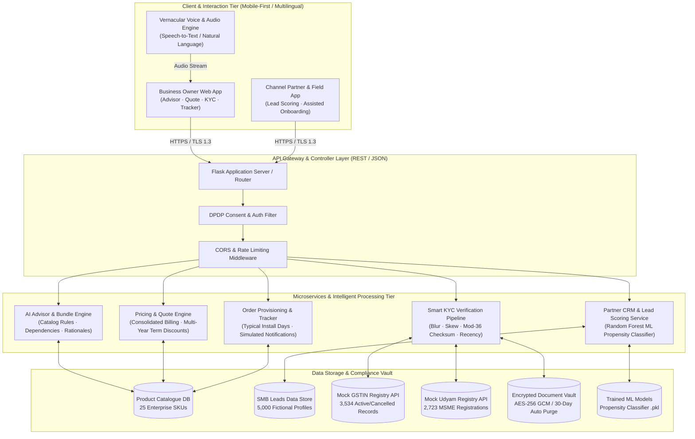
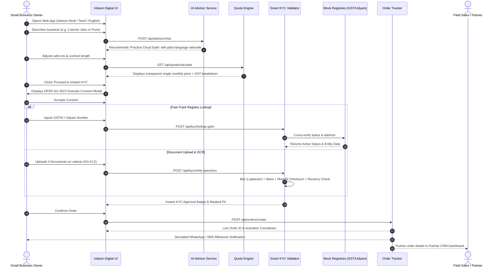

# Project Udyam Digital: Solution Architecture & Technical Design
### Digital-First Acquisition, Smart KYC, and Onboarding Engine for MSMEs
**Airtel SYNC Hackathon 2026 · Track A**

---

## 1. High-Level Architectural Overview

Project Udyam Digital is an enterprise-grade, microservice-ready web application built to transform telecommunication customer acquisition for over 6 crore Indian MSMEs. The platform collapses a 17.6-day legacy field-sales journey into a streamlined 5-minute digital self-service flow.

---

## 2. End-to-End Customer Journey Sequence

---

## 3. Core Microservices Description

### 3.1 AI Conversational Advisor & Bundle Engine (`services/advisor_engine.py`)
* **Dynamic Archetype Mapping:** Matches diverse MSME profiles into 4 core segments:
  * **Micro Retail & Services (55%):** Kiranas, salons, pharmacies.
  * **Professional Offices (25%):** Clinics, CA firms, coaching centres, legal practices.
  * **Small Multi-Site Businesses (15%):** 3–10 store chains, restaurants.
  * **Small Manufacturers (5%):** Fabrication units, textile mills, plants.
* **Strict Rule & Dependency Validation:**
  * Enforces `requires_gstin = Y` strictly (omitting enterprise SKUs like Leased Lines, SD-WAN, and Cloud Telephony for non-GST registered micro businesses).
  * Enforces `requires_one_of` prerequisites (e.g., `P09 Backup Failover` requires `P01|P02|P03|P05|P06`).
* **Plain Language Rationales:** Generates contextual explanations answering *why* each SKU is included, rendered in 4 languages (English, Hindi, Hinglish, Tamil).

### 3.2 Transparent Quote & Pricing Engine
* Calculates transparent, all-inclusive monthly prices combining connectivity, cloud storage, security, and communication.
* Computes statutory 18% GST and clearly separates one-time setup fees.
* Offers 12, 24, and 36-month contract toggles with structured discounts (up to 15% off and waived setup fees).

### 3.3 Smart KYC & Fraud Detection Engine (`services/kyc_validator.py`)
* **Computer Vision Checks:**
  * **Blur Detection:** Uses 2D Laplacian convolution variance. Images with variance $< 100$ are flagged as blurred (catches applicant K04).
  * **Skew Detection:** Analyzes horizontal projection profile variance. Variance $< 12,000,000$ indicates tilted/rotated documents (catches applicant K02).
* **Cryptographic & Syntax Checks:**
  * **Mod-36 Checksum Validation:** Implements official 15-character GSTIN check digit algorithm, catching fraudulent character alterations (catches applicants K02 and K08).
  * **Udyam Format Validation:** Regex pattern matching `UDYAM-[A-Z]{2}-\d{2}-\d{7}`.
  * **90-Day Recency Validation:** Verifies utility bill date against hackathon reference date `2026-07-15` (catches applicant K11 with bill dated `2025-10-31`).
  * **Signatory Role Verification:** Enforces proper governance structures (e.g., LLP requires Designated Partner; catches applicant K09 and K10).
  * **Registry Cross-Verification:** Checks against 3,534 GSTIN records and 2,723 Udyam records (catches K01 Cancelled status and K06 tampered GSTIN).

### 3.4 Partner CRM & Machine Learning Propensity Service (`services/crm_service.py`)
* **Conversion Propensity Classifier:** Random Forest machine learning model trained on the 5,000 `smb_leads.csv` dataset, predicting likelihood of activation (High / Medium / Low).
* **Next-Best-Action Engine:** Prescribes specific recovery actions for leads stalled at various funnel stages (e.g., offering AirFiber for price-sensitive leads; sending self-serve WhatsApp links for leads with no time for visits).
* **Assisted Onboarding Mode:** Empowers field agents and local channel partners to onboard customers on-site in under 5 minutes without channel friction.

### 3.5 Real-Time Order Tracker & Post-Sale Service
* Provides visual milestone tracking:
  1. Order Placed & Confirmed
  2. Instant Smart KYC Approved
  3. CPE & SIM Card Dispatched
  4. Fiber Engineer Visit Scheduled
  5. Service Activated
* Dynamic activation date forecasting based on the bundle's `typical_install_days`.
* Eliminates the 3+ manual status chase calls identified in the baseline case.
